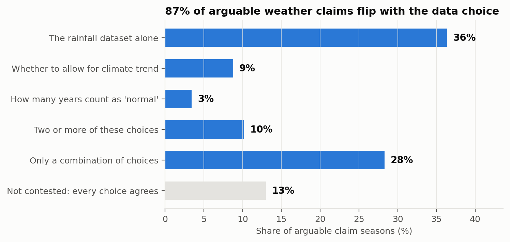
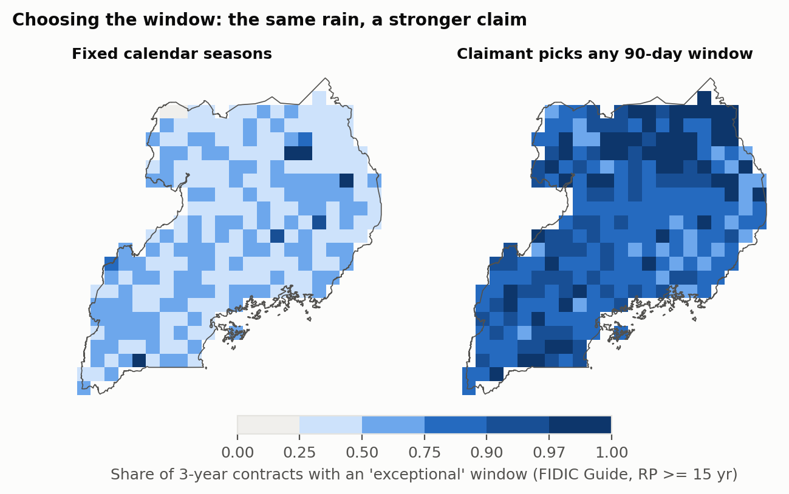
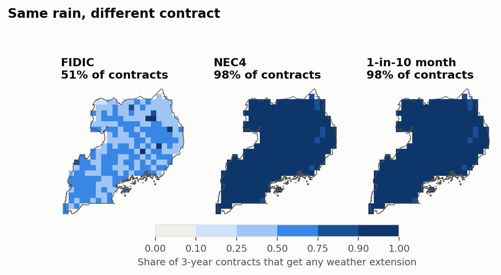
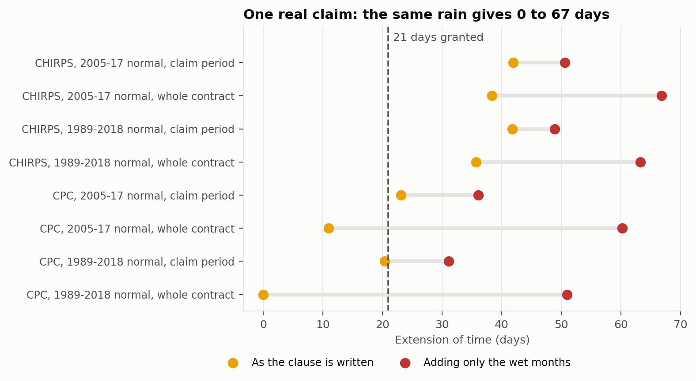
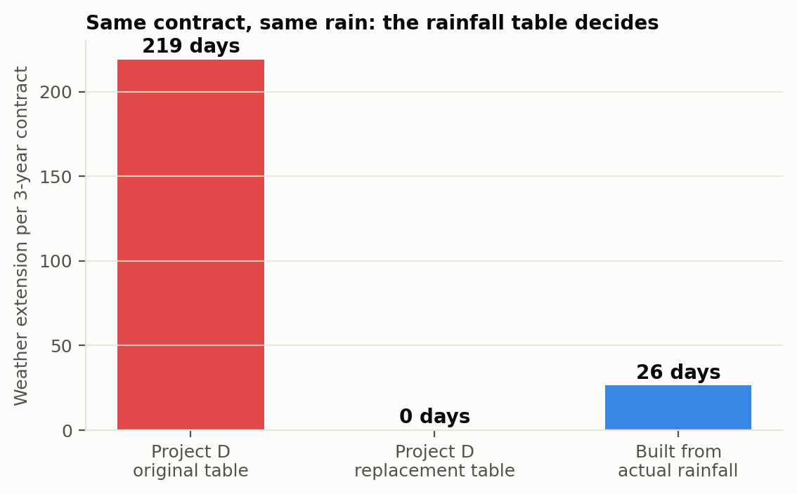
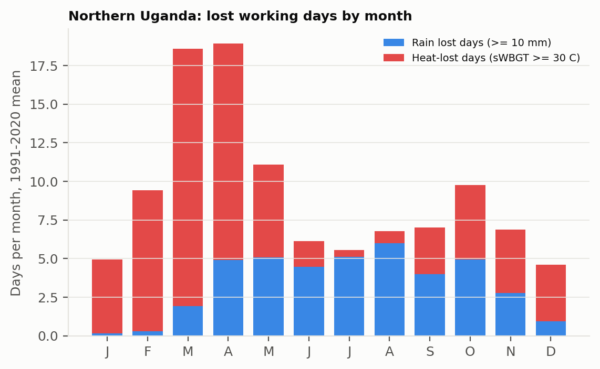
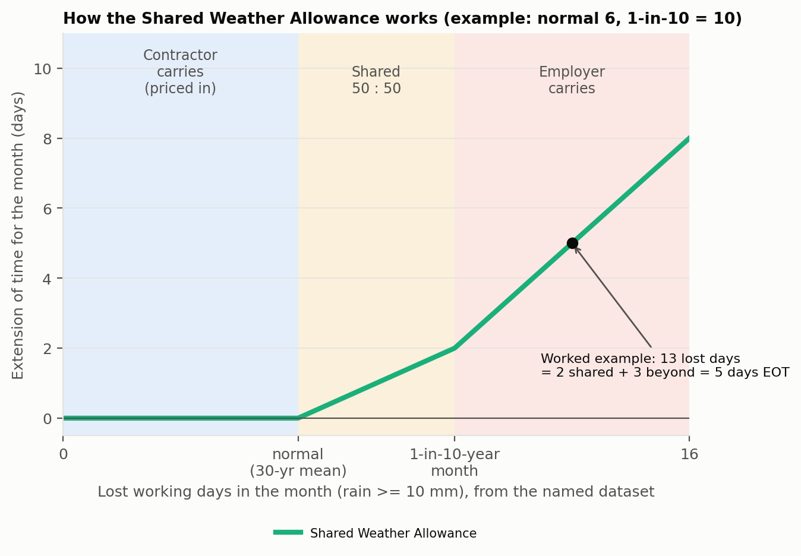
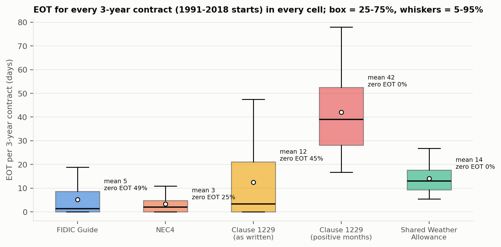

# Same rain, different verdict

*Why "it rained a lot" is one of the most argued sentences in Ugandan construction, and what the data say about it*

---

Every road contractor in Uganda knows the sentence. It turns up in monthly progress reports, in extension-of-time claims and in the Engineer's determinations: *"Delay due to adverse weather conditions experienced during the rainy season."*

And every Engineer knows the reply that should follow. I wrote it myself, in the margin of a contractor's monthly report not long ago: *Is it just rain, or inclement weather? Has the rainfall data reflected this?*

That question is harder to answer than it looks. Over the past weeks I have been trying to answer it properly, for the whole of Uganda, with 45 years of daily rainfall data. Here is what I found.

## The clause nobody can measure

Most of our public road works use FIDIC conditions of contract. Under FIDIC, a contractor delayed by weather gets more time, but only if the conditions were **"exceptionally adverse"**. The 1999 FIDIC books never say what "exceptional" means. The 2017 books say it must be "Unforeseeable having regard to climatic data", but not which data, from where, or over how many years.

The FIDIC Contracts Guide offers a rule of thumb: an event is exceptional if it would happen less often than once in four to five times the contract period. For a typical 3-year Ugandan road contract, that means roughly a 1-in-12 to 1-in-15-year event.

Uganda goes further than most countries. The Ministry of Works General Specifications for Road and Bridge Works contain an actual formula, Clause 1229, that converts each month's rainfall into days of extension. It compares the month with the long-term average. But the average comes from rainfall records "provided in the Special Specifications, **or as agreed to, in writing, by the Engineer**."

So even our formula leaves open the two things that decide the answer: *which* rainfall data, and *which* years count as normal.

## What I did

I took every 25 km × 25 km grid square in Uganda (268 of them) and daily rainfall from three different public datasets going back to 1981. I then imagined a 3-year contract starting in every single month since 1991, and asked of each one: was the weather "exceptional", and how many days would the contract give?

I applied the tests as they are written: the FIDIC Guide rule, the UK's NEC4 rule, a JCT-style practice and our own Clause 1229. The weather is the same in every case; only the test changes.

## Finding 1: most arguable claims can be argued both ways

Take every rainy season since 2001 in every part of the country. In about **one season in four**, at least one reasonable choice says "exceptional": a different dataset, a different number of baseline years, or allowing for a trend.

But in **87% of those seasons**, another equally reasonable choice says "not exceptional".

The biggest source of disagreement is not how many years of records you use. It is **which dataset** you use. Two respected satellite rainfall products, used by meteorologists across Africa, disagree on whether the record rains of October–December 2019 were "exceptional" in **40% of Uganda**.

One of these datasets also turned out to contain a silent error: from 2020 to 2023 it reads about 1.5 to 3 times wetter than the others. Used without checking, it would have made *every* rainy-season claim in 2020 "exceptional".

*Only 13% of arguable claim seasons get the same answer under every reasonable choice. The rainfall dataset alone flips the verdict in 36%.*

## Finding 2: the claimant chooses the window

Contracts don't say whether the weather must be judged by calendar month, by season, or over any period the contractor picks. That matters a lot.

If you judge by fixed seasons, about **half** of 3-year contracts contain an "exceptional" season. If the contractor can pick *any* 90-day stretch, that rises to **nearly nine in ten**. It's the same rain; the claim is stronger only because the window was chosen after the event.

*Share of 3-year contracts with an 'exceptional' window. Left: fixed calendar seasons. Right: the claimant picks any 90-day stretch after the event.*

## Finding 3: the same rain, a different contract, a different answer

Under the same weather:

- **NEC4** triggers on almost every contract, but gives only about **4 days** on average, because it pays only for weather beyond the 1-in-10-year level.
- **FIDIC's Guide rule** triggers on about **half** of contracts and gives about **6 days**. But it is the least predictable, and for **44%** of contracts, whether you get any time at all depends on which dataset you use.
- **Clause 1229 applied as written** gives about **13 days** per contract.

And then there is practice. The clause says the monthly results must be added *algebraically*, so drier-than-normal months cancel wetter ones. In a real claim I reviewed, the dry months were simply recorded as zero and only the wet months were added. Applied that way across Uganda, Clause 1229 gives **43 days** per contract, more than three times as much. That is more than all the abnormal rain actually caused. Ordinary month-to-month variation becomes extension of time.

*The same rain, 1991-2025. Under FIDIC's Guide rule about half of 3-year contracts get any weather extension; under NEC4 or a 1-in-10 month rule almost all do.*

## Finding 4: one real claim, many answers

On one real (anonymised) road package, the contractor claimed 21 days under Clause 1229. They used 13 years of records from a single weather station and added only the positive months. The Engineer accepted the figure as presented.

I recomputed it with independent data. Depending on the dataset, the baseline years and the period assessed, the *same clause on the same contract* gives anything from **0 to 42 days**, and up to **67 days** if only the wet months are added, as the claim did. The datasets don't even agree on which months were the abnormal ones.

*One real claim, recomputed. Each row is a defensible choice of dataset, baseline years and period. Orange: the clause as written. Red: adding only the wet months. The dashed line is the 21 days granted.*

Nobody here was acting in bad faith. The clause simply does not determine the answer until someone fixes the data.

## Finding 5: the table in the contract decides

Some contracts try to fix the data by printing a table of "average" monthly rainfall in the Special Specifications. I read the signed contracts of several road projects. The tables don't match the rainfall at the site:

- One table was headed with the name of a weather station at the **opposite end of the country**.
- Its replacement, issued as a tender addendum, adds up to **almost 6,000 mm of rain a year**, about four times what actually falls there.
- Another contract's table lists **251 heavy-rain days a year and 128 mm of rain**. The rows have clearly been mixed up.

I ran the contract's own formula through 20 years of real rainfall with each table:

- With the original table, a typical 3-year contract would earn about **219 days** of weather extension.
- With the replacement table, it would earn **zero, ever**.
- With a table built from the actual rainfall record, it would earn about **26 days**.

One page, typed at tender and rarely checked, decided the weather entitlement more than the weather did.

*The same contract and the same rain, run through each rainfall table. The table printed at tender, not the weather, decides the answer.*

## Finding 6: climate change is coming for the baseline

Most contracts implicitly freeze "normal weather" at the time of tender. I ran ten bias-corrected climate models for 2041–2070. In the middle of the range, a typical 3-year contract loses about **8–10 more working days** to heavy rain than today, and some wetter models give far more.

Who carries those days depends on a line no Ugandan contract contains:

- **If "normal" is frozen at tender**, FIDIC weather extensions rise by roughly **40–80%**, and the employer (mostly the taxpayer) absorbs the change.
- **If "normal" is updated**, extensions barely change, and the contractor absorbs the extra days, which will end up in tender prices.

Either can be fair. But today, no Ugandan contract says which.

The Shared Weather Allowance turns out to be the most stable here too: with a frozen table, its extensions rise by about a quarter to a third, less than any other rule I tested.

## Finding 7: heat is the hazard nobody measures

"Climatic conditions" doesn't only mean rain. Our contracts, though, measure only rain. In northern Uganda the afternoon heat can make heavy outdoor work unsafe, yet no clause tells anyone when heat counts as exceptional.

Using a standard heat-stress index (combining temperature and humidity), I found that:

- heat already causes about **a third of all weather-lost working days** in Uganda, and **more than half in the North**;
- heat-lost days have been rising by about **6 days per decade**;
- with 1.3–1.8 °C of warming by mid-century, a 3-year contract in the North could face **three times as many heat-lost days** as today.

If contracts keep "normal" frozen at tender, nearly every contract would have "exceptional" heat by then, and the test would mean nothing.

*Northern Uganda: average working days lost each month to heavy rain (blue) and to heat stress (red), 1991-2020. From January to May, heat costs more working days than rain.*

## A better way to calculate it: the Shared Weather Allowance

Instead of arguing after the event about whether the rain was "exceptional", I propose a calculation that both parties can do on the day the contract is signed. I call it the **Shared Weather Allowance (SWA)**.

**Before tender**

1. **Name the data.** The Contract Data states one rainfall dataset and one location for each section of the works (a grid square or a named station). The data are checked for errors first, and the contract says who bears the risk if they turn out to be wrong.
2. **Publish the table.** For each calendar month, the contract lists two numbers for that location, worked out from the last 30 years:
   - the **normal** number of lost working days (days with 10 mm of rain or more), and
   - the **1-in-10-year** number: a month that wet happens only one year in ten.

   Contractors price the normal days into their programme. Everyone sees the same table before bidding.

**During the works**

3. **Count each calendar month** (not a period chosen afterwards) using the named data.
4. **Share the extra days in bands:**

| Lost working days in the month | Who carries them |
|---|---|
| Up to the normal | Contractor (already priced) |
| Between normal and 1-in-10-year | **Shared 50:50**: half the extra days become extension of time |
| Beyond the 1-in-10-year level | Employer: every extra day becomes extension of time |

*How the Shared Weather Allowance splits a wet month: normal days are the contractor's, days up to the 1-in-10 level are shared, days beyond it are the employer's. The dot is the worked example below: 13 lost days give 5 days of extension.*

5. **Add up the months** over the contract, then apply the usual delay analysis for overlapping causes.
6. **State how "normal" moves with the climate.** The table is based on the 30 years before award, and the contract says whether, and when, it is updated on long contracts.

**A worked example.** Suppose a site's table says May normally has 6 lost days and a 1-in-10-year May has 10. This May there were 13.

- The first 6 days are the contractor's, already in the programme.
- Days 7–10 are 4 shared days, so 2 days of extension.
- Days 11–13 are 3 days beyond the 1-in-10 level, so 3 days of extension.
- Total: **5 days of extension of time for May.**

There's no argument about which dataset, which window or which years: they were all fixed at tender.

**How it performs.** Tested on every 3-year contract since 1991 in every part of Uganda, the SWA:

- gives about **14 days per contract**, close to Clause 1229 applied correctly (13 days) and far from the 43 days of the positive-months-only practice;
- **never** flips between "relief" and "no relief" depending on the dataset (FIDIC's Guide rule does so for 44% of contracts);
- is about **three times more predictable** from one contract to the next than the current tests;
- splits abnormal weather roughly **60:40** between employer and contractor, instead of all-or-nothing.

*Extension of time for every 3-year contract (1991-2018 starts) in every part of Uganda. The Shared Weather Allowance gives a narrow, predictable range and never zero. The other rules often give nothing, or swing widely.*

I'll publish the monthly tables for every location in Uganda with the full study, so any engineer can put them straight into a contract.

## What would fix it

To sum up:

1. **Name the dataset and location in the contract**, with the monthly tables attached at tender. This alone removes most of the disagreement.
2. **Check the data for errors before relying on it**, and say who bears the risk if it is wrong.
3. **Fix the window**: calendar months, not periods chosen after the event.
4. **If we keep Clause 1229, apply it as written**: algebraic sum over the whole contract period.
5. **Better still, move to the Shared Weather Allowance**: shared bands instead of all-or-nothing.
6. **Say what happens as the climate shifts**: is the baseline frozen at award, or updated?
7. **Count heat too**, with a named index and threshold, especially for northern and eastern contracts.

## Why this matters

Weather is one of the top causes of delay on Ugandan roads. Each disputed day of extension has a price: delay damages, prolongation costs, consultants' time, and sometimes a dispute board or arbitration. Much of that argument is not about what the rain did. It is about which spreadsheet of rain we agree to look at.

That part, at least, we can settle before the first shovel goes in.

---

*This is part of an ongoing research project on climate risk and construction disputes in Uganda. A full academic paper is in preparation. If you work on Ugandan or East African contracts (as an engineer, contractor, employer, adjudicator or lawyer) and have seen weather claims argued, I'd like to hear from you.*

*— Gava Charles*

---

**Cover image:** figures/cover_substack.png (1456 × 816; use as the post header and social preview)

**Images** (in order; upload each where the `![...]` line sits, and use the italic line as the caption):

1. Finding 1: figures/substack_contested.png
2. Finding 2: figures/rq2b_window_map.png
3. Finding 3: figures/substack_three_contracts.png
4. Finding 4: figures/substack_project_claim.png
5. Finding 5: figures/substack_contract_tables.png
6. Finding 7: figures/substack_rain_heat.png
7. SWA, after the bands table: figures/substack_swa_schematic.png
8. SWA, after "How it performs": figures/fig15_eot_distribution.png

Figures 1, 3 and 4 are generated by `src/substack_figs.py`; 5-7 by `src/figs_extra.py`.
